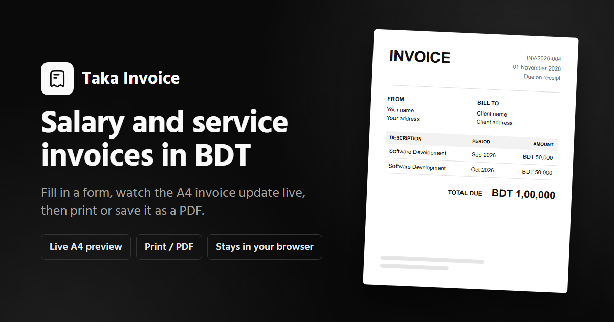

# Taka Invoice

Create, preview and print salary and service invoices in Bangladeshi Taka (BDT), right in the browser.

Taka Invoice is for freelancers, contractors and employees in Bangladesh who bill a client or employer every month. Fill in a short form, watch an A4 invoice update as you type, then print it or save it as a PDF. There is no account and no server: your details stay in your browser.

**Live app:** <https://taka-invoice.netlify.app>

[](LICENSE)



## What it does

- **Live A4 preview.** The invoice sheet on screen is the page you print, and it scales to fit any screen width.
- **One line per month in one click.** Pick a month range (for example March to November), a monthly amount and a description, then click **Fill months**. The app adds one line per month and sets the service period, such as `01 March - 30 November 2026`.
- **Searchable month picker.** Type `ma` to narrow the From and To lists to March and May.
- **Sensible defaults.** The invoice date starts as today, the service period starts as the previous calendar month, and the invoice number starts as `INV-<year>-001`.
- **Taka formatting.** Amounts use South Asian digit grouping, so 100000 shows as `BDT 1,00,000`.
- **Editable lines.** Each line has a multi-line description, a period and an amount, and the total updates automatically.
- **Remembers your details.** Everything you type is saved in this browser and restored next time. **Clear form** removes it.
- **Light and dark themes**, following your system setting by default. The printed sheet is always black on white.

## Use the app

1. Open <https://taka-invoice.netlify.app>.
2. Fill in **From (you)**, **Bill to**, **Invoice info** and **Payment details**. Leave e-TIN blank to hide it; leave account holder blank to use your name.
3. Under **Lines**, choose the months and monthly amount and click **Fill months**, or click **Add a line** to add lines by hand.
4. Click **Print / save as PDF**. In the print dialog, choose **Save as PDF**, **A4** paper and **no margins**.

The browser tab title becomes `Invoice <number> - <your name>`, which most browsers suggest as the PDF file name.

## Run it locally

**Prerequisites:** Node.js 22.12 or newer and npm. The repository pins Node 24 in [`.nvmrc`](.nvmrc).

```bash
git clone https://github.com/montasim/taka-invoice.git
cd taka-invoice
npm ci
npm run dev
```

Vite prints a local address, normally `http://localhost:5173`. Open it and you should see the invoice form next to an A4 invoice preview.

### Scripts

| Command | What it does |
| --- | --- |
| `npm run dev` | Start the development server with hot reload |
| `npm run build` | Type-check (`tsc -b`) and build the production site into `dist/` |
| `npm run typecheck` | Type-check only |
| `npm run lint` | Lint with oxlint |
| `npm run check` | Lint, then build (the same checks as CI) |
| `npm run preview` | Serve the production build from `dist/` |

## Configuration

There are no environment variables or secrets.

- **Site identity** comes from [`package.json`](package.json): `displayName`, `description`, `homepage` and `repository`. [`vite.config.ts`](vite.config.ts) turns these into the page title, description, canonical URL, Open Graph and Twitter tags in `index.html`, and generates `site.webmanifest`, `robots.txt` and `sitemap.xml`. The app reads the same values through [`src/config/site.ts`](src/config/site.ts). Change them in `package.json` only.
- **Social preview image** is [`public/social-preview-v1.png`](public/social-preview-v1.png) (1200×630 PNG). If you replace it, give it a new file name (for example `-v2`) and update `ogImage.path` in `vite.config.ts`, so link previews pick up the change.
- **Form defaults** such as the Bill to name and address and the line description live in [`src/features/invoice/constants.ts`](src/features/invoice/constants.ts).

## How it is built

React 19 and TypeScript on Vite, styled with Tailwind CSS v4 and [shadcn/ui](https://ui.shadcn.com) components, with [Hugeicons](https://hugeicons.com) icons, Sonner toasts and next-themes. The Hind Siliguri font is bundled with the app, so no third-party requests are made.

```text
src/
├─ App.tsx                    # page layout; documents the spacing scale
├─ config/site.ts             # site identity injected from package.json
├─ components/
│  ├─ layout/                 # header, footer, logo, GitHub button
│  ├─ theme-toggle.tsx
│  └─ ui/                     # shadcn/ui components
└─ features/invoice/          # the invoice feature (public API in index.ts)
   ├─ types.ts, constants.ts
   ├─ context/, hooks/        # invoice state, saving to localStorage
   ├─ lib/                    # formatting, month lines, defaults, storage
   └─ components/
      ├─ form/                # form card, sections, month picker, line rows
      └─ preview/             # the A4 invoice sheet
```

## Deploy to Netlify

[`netlify.toml`](netlify.toml) defines the build: `npm run build`, publish directory `dist`, Node 24. It is a static site with no server functions.

1. Push the repository to GitHub.
2. In Netlify, choose **Add new site → Import an existing project**, then pick the repository.
3. Netlify reads `netlify.toml`, so the build settings need no changes. Deploy.

`netlify.toml` also sends security headers on every page: a Content-Security-Policy that only allows the site's own scripts, fonts and images, plus HSTS, `X-Frame-Options: DENY`, `nosniff`, a strict referrer policy and a permissions policy. Files under `/assets/` are cached for a year because Vite fingerprints their names. There is no catch-all redirect: the app has one page, so unknown paths return Netlify's 404.

## Privacy and limits

- **Data stays on your device.** The app has no backend, accounts or analytics. Your details are stored only in this browser's `localStorage` (key `taka-invoice:v1`). Anyone using the same browser profile can see them, so use **Clear form** on shared computers.
- **One invoice at a time.** Saving a new invoice replaces the previous one; there is no invoice history.
- **BDT only.** Amounts are always shown in Bangladeshi Taka.
- **Long invoices print on two pages.** About eight single-line lines fit on one A4 page; more lines, longer addresses or multi-line descriptions continue onto a second page.
- **Not accounting or tax software.** The app formats the numbers you enter. It does not calculate tax or VAT, and does not check that an invoice meets legal requirements.

## Contributing

Bug reports and pull requests are welcome. See [CONTRIBUTING.md](CONTRIBUTING.md) for setup, checks and code layout, and use [GitHub issues](https://github.com/montasim/taka-invoice/issues) for bugs and ideas. Please report security vulnerabilities privately as described in [SECURITY.md](SECURITY.md).

## License

[MIT](LICENSE) © 2026 Mohammad Montasim Al Mamun Shuvo
